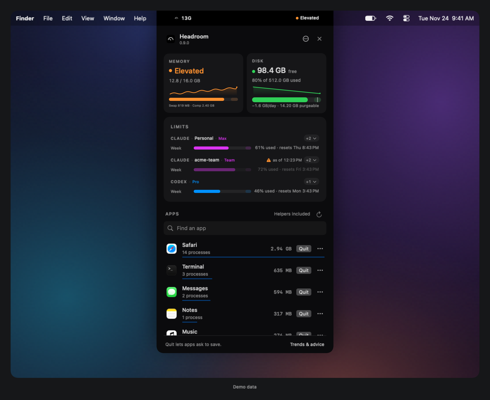
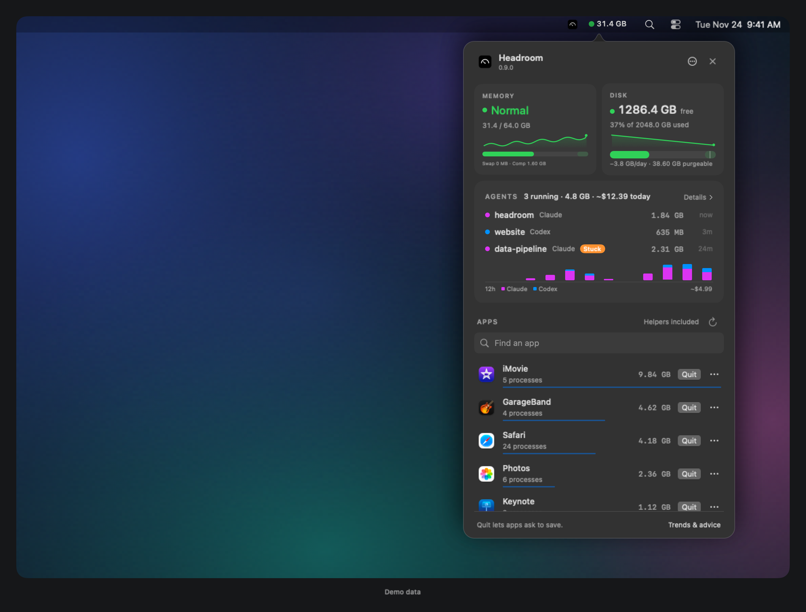
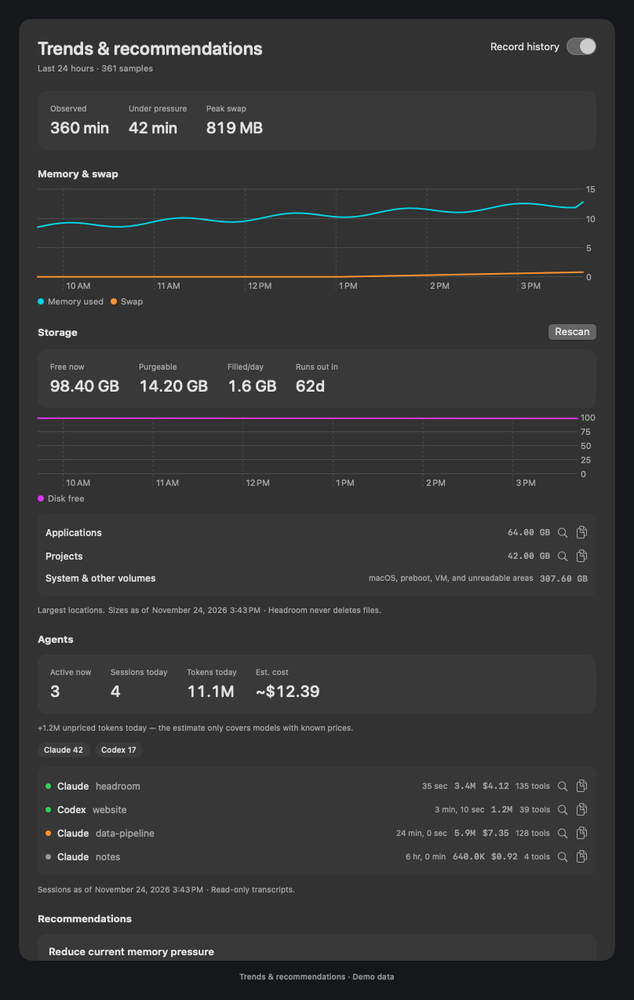

# Headroom

<p align="center">
  
</p>

**How much room does your Mac have left?** Headroom is a small native macOS
utility that shows memory pressure and free disk space where you already
look: in the notch on MacBooks, or in the menu bar on other Macs. Open it to
see which apps use the most memory and quit them safely, follow 24-hour
trends, and optionally keep an eye on your coding-plan limits and running
coding agents. It reads what macOS already measures, keeps its history on
your Mac, and never deletes anything.

<p align="center">
  
  
</p>

## Download

- **[Download the latest release](https://github.com/il-figlio/headroom/releases/latest)**
  from GitHub Releases. Unzip it and move `Headroom.app` to your
  Applications folder.
- **Homebrew** (coming soon):

  ```sh
  brew install --cask il-figlio/tap/headroom
  ```

Releases are signed with a Developer ID and notarized by Apple.

## Requirements

- macOS 13 Ventura or later
- Apple Silicon or Intel

## What it shows

- **Memory pressure:** Normal, Elevated, or Critical, straight from the
  kernel, with memory used, swap, and compressed memory.
- **Disk:** free, purgeable, and total space, the rate it's filling, and an
  estimate of days until full.
- **Apps:** each app's memory, including its helper processes, with
  **Quit** (apps can ask you to save) and a confirmed **Force Quit**.
  Nothing is ever quit automatically.
- **Limits:** your Codex and Claude plan usage windows and reset times,
  using sign-ins already on your Mac. Off until you turn it on.
- **Agents:** running coding-agent sessions, their memory, and today's
  tokens and estimated spend. Off by default.
- **Trends:** 24-hour memory and disk charts, time spent under pressure,
  recommendations, and an on-demand list of the largest folders.

Hover over any row, meter, or tile for details. Hide or show cards from the
panel's **···** menu.

<p align="center">
  
</p>

Screenshots use the app's real views with invented demo data.

For the details behind each reading, see [How Headroom works](docs/how-it-works.md).

## Privacy

Headroom has no account, no analytics, and no telemetry. Your history stays
on your Mac for 30 days. Headroom connects to the internet only to check
for updates and, if you turn on Limits, to ask Codex and Claude for your own
plan usage. Agents reads coding-agent transcripts read-only and keeps only
metadata such as token counts. [PRIVACY.md](PRIVACY.md) lists exactly what
is read, stored, and sent.

## Updates

Headroom updates itself with [Sparkle](https://sparkle-project.org). It
checks once a day, and every update is signed and verified before it's
installed. You can turn off automatic checks or automatic installation in
Headroom's settings, and check manually at any time.

## Uninstall

1. In Headroom's settings, turn off **Launch at Login**, then quit Headroom.
2. Move `Headroom.app` from Applications to the Trash.
3. To remove your history and settings too:

   ```sh
   rm -rf ~/Library/Application\ Support/Headroom
   defaults delete org.headroom.app
   ```

If you built Headroom from source, the build also created a local
code-signing keychain at
`~/Library/Application Support/Headroom/signing/`. Step 3 removes it; to
remove it on its own, run:

```sh
security delete-keychain ~/Library/Application\ Support/Headroom/signing/headroom-signing.keychain-db
```

## Build from source

You need macOS 13 or later and Swift 5.9 or later (Xcode or the Command Line
Tools). See [CONTRIBUTING.md](CONTRIBUTING.md) for building, testing, and
the project's design rules.

## Contributing

Bug reports, ideas, and pull requests are welcome: see
[CONTRIBUTING.md](CONTRIBUTING.md). Report security problems privately as
described in [SECURITY.md](SECURITY.md). Changes are listed in
[CHANGELOG.md](CHANGELOG.md).

## License

[MIT](LICENSE). Headroom includes [Sparkle](https://sparkle-project.org),
which has its own [license](Resources/Sparkle-LICENSE).
